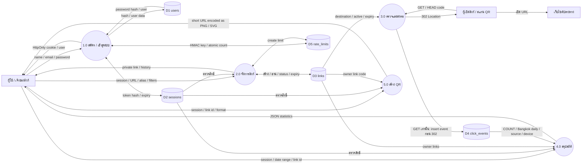
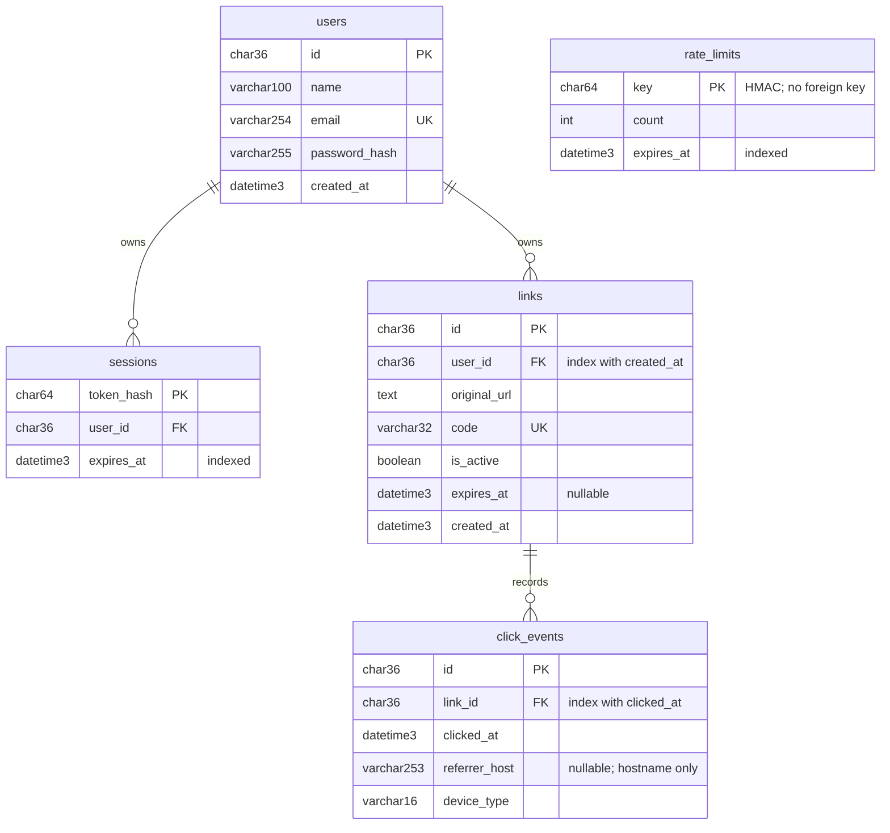
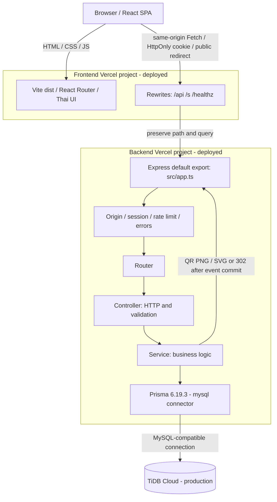

# แผนภาพระบบ

สร้างจาก Mermaid source ใน `docs/diagrams/` ระบบ production deploy แล้ว: React SPA และ Express API อยู่คนละ Vercel project, ฐานข้อมูลเป็น TiDB Cloud ตามข้อมูลผู้ดูแล ส่วน local/CI ใช้ MySQL 8.4 Backend เป็น Modular Monolith ไม่ใช่ Microservices

Frontend: https://project-short-url-react-node.vercel.app · Backend: https://project-short-url-react-node-osq6.vercel.app

ดูหลักฐานการตรวจใน [verification.md](verification.md)

## DFD Level 0

[เปิด SVG](diagrams/dfd-level-0.svg) · [เปิด PNG](diagrams/dfd-level-0.png)

## ER Diagram

[เปิด SVG](diagrams/er.svg) · [เปิด PNG](diagrams/er.png)

## Architecture Diagram

[เปิด SVG](diagrams/architecture.svg) · [เปิด PNG](diagrams/architecture.png)

rate_limits ไม่มี foreign key เพราะจำกัดทั้ง IP ก่อนล็อกอินและ user หลังล็อกอิน ใช้ HMAC key ไม่เก็บ IP ตรง ๆ FK ที่มีใน schema ใช้ cascade; ไม่มี API hard delete ในรุ่นแรก ข้อมูลเวลาเก็บ UTC และสรุปวัน Bangkok +07:00
